<p align="center">
  
</p>

<h1 align="center">Zimbabwe Compliance for ERPNext</h1>

<p align="center">
  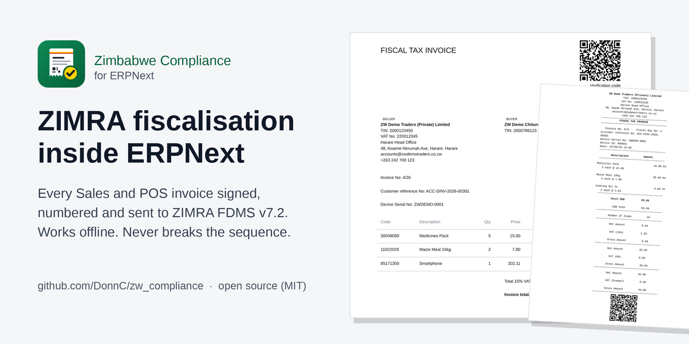
</p>

`zw_compliance` makes ERPNext compliant with Zimbabwean tax law, starting with
**ZIMRA fiscalisation**. The ERPNext site registers with ZIMRA's Fiscalisation
Data Management System (FDMS) as a virtual fiscal device. Every Sales Invoice
and POS Invoice is then signed, numbered, chained, reported to ZIMRA and
printed in ZIMRA's mandatory layouts, with no extra steps for the person at
the till.

It follows the pattern of ERPNext's regional apps (India Compliance, the UAE
VAT module): native documents, standard permissions, standard print formats
and reports. There is no middleware service to run.

| | |
|---|---|
| **Specification** | ZIMRA *Fiscal Device Gateway API* v7.2 (online mode) |
| **Platform** | Frappe / ERPNext v15+ |
| **Licence** | MIT |
| **Status** | Fiscalisation complete; payroll (PAYE, NSSA, ZIMDEF) next, see [Roadmap](#roadmap) |
| **Maintainer** | [Donald Chinhuru (@DonnC)](https://github.com/DonnC) |

---

## Contents

- [What it does](#what-it-does)
- [How it works](#how-it-works)
- [Screenshots](#screenshots)
- [See it with demo data](#see-it-with-demo-data)
- [Install](#install)
- [Set up a fiscal device (10 minutes)](#set-up-a-fiscal-device-10-minutes)
- [Daily use](#daily-use)
- [Remote API](#remote-api)
- [Quality](#quality)
- [Documentation](#documentation)
- [Roadmap](#roadmap)
- [Contributing, security, credits](#contributing)

## What it does

**Fiscal device lifecycle**
- Guided onboarding on the device form: verify the taxpayer with ZIMRA, register, receive the certificate, pull configuration. One click per step.
- The ECC P-256 device key is generated on the server and stored encrypted, in a field only managers can see.
- Certificate expiry warnings, with renewal by one click or automatically (opt-in).
- Ping at ZIMRA's reporting frequency, plus a server-corrected clock so receipt dates never drift.
- Several devices per company, chosen by POS Profile or by a company default.

**Receipts**
- Sales Invoices and POS Invoices are fiscalised on submit.
- Invoices, credit notes (returns, including partial ones) and debit notes are covered.
- Credit notes are negative, as the specification requires. Required notes, the original receipt reference, the 12-month limit, same currency, the credit limit and the original's taxes are all enforced before submit.
- Receipt amounts are in the invoice currency, with tax computed per ZIMRA tax group (no cent drift).
- Line and document discounts and multi-currency (USD, ZWG and so on) are supported.
- Cash change and POS rounding become correct payment lines.
- Unpaid balances and advances map to ZIMRA money types.
- Buyer details are sent only for registered buyers (TIN), so walk-in sales are never rejected.
- HS codes are required and length-checked per ZIMRA rules. They come from the item, or are inherited from the item group. ZIMRA's national HS list is pre-loaded.

**Sequencing that cannot break**
- Global number, counter, hash chain, signature and QR code are produced **inside the invoice's own database transaction**, under a device row lock.
- A failed or rolled-back submit therefore never uses up a number. Two cashiers never get the same one.
- A background job then sends receipts to ZIMRA strictly in order, retrying safely when the connection drops.

**Fiscal days**
- Days open automatically on the first sale, or at a set time.
- The business is warned before ZIMRA's maximum day length. Days close automatically at a set time or before the limit, and the next sale rolls into a new day.
- Before closing, counters are recomputed from the signed receipts and cross-checked with ZIMRA. A close is refused while any receipt is Grey or Red (the reason is shown).

**Printing** (spec §10)
- *Receipt48* (80 mm) and *Invoice A4*, for invoices, credit notes and debit notes, with QR code and verification code.
- *Z report* for a closed day, *X report* for an open one.

**Taxes, set up the ERPNext way**
- From ZIMRA's tax table, the app creates:
  - the VAT output (liability) and input (asset) accounts;
  - Sales and Purchase Taxes and Charges Templates, with the standard rate as the company default;
  - Item Tax Templates for zero-rated and exempt goods;
  - a mapping that ties each one to its ZIMRA tax.
- Supplier invoices use the matching purchase templates. Input VAT goes to the input account, and the VAT Summary report sets it against output VAT.

**Reports and workspace**
- A *ZIMRA Fiscalisation* workspace in two parts:
  - **Compliance health**: unfiscalised invoices, receipts awaiting ZIMRA, rejected and flagged receipts, devices with sync errors, day closes pending, hours left in the fiscal day, certificate days left; plus live lists of what needs attention;
  - **Sales and VAT**: fiscal sales per day and output VAT per tax (per currency), receipts by status, type and day, credit notes.
- Six reports:
  - **Fiscal Day Summary**
  - **Fiscal Receipt Register**
  - **Sync Exceptions**: anything not yet accepted, or flagged by ZIMRA, with the fix
  - **VAT Summary**: output vs input
  - **Fiscalisation Reconciliation**: every submitted invoice vs its receipt; finds gaps before ZIMRA does
  - **Device Status**

**Safe by default**
- Fiscal receipts are read-only for everyone, including System Manager, and cannot be deleted.
- A fiscalised invoice cannot be cancelled or deleted; the user is told to issue a credit note.
- Copies and amendments never carry fiscal numbers.
- Device secrets are restricted to a higher permission level.
- The app cannot be uninstalled while receipts are unsent (spec §9 req. 22).

## How it works

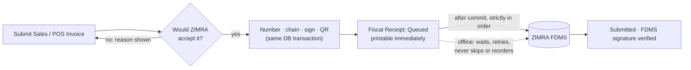

The ZIMRA protocol itself lives in `zw_compliance/fdms`, a pure Python library
with no Frappe dependency, tested against the specification's own examples.
The Frappe layer (`zw_compliance/fiscalisation`) maps ERPNext documents onto
it. See [docs/ARCHITECTURE.md](docs/ARCHITECTURE.md).

Online first, offline safe: while ZIMRA is reachable a receipt is accepted
within seconds of submit. When it is not, invoicing carries on. Receipts are
already signed and printable, and they queue until the connection returns.
Because order is enforced, the queue drains without gaps or duplicates (§4.7).

## Screenshots

What ZIMRA requires on paper (§10), produced from ERPNext:

| A4 fiscal tax invoice | 80 mm receipt (Receipt48) | Z report |
|:---:|:---:|:---:|
| 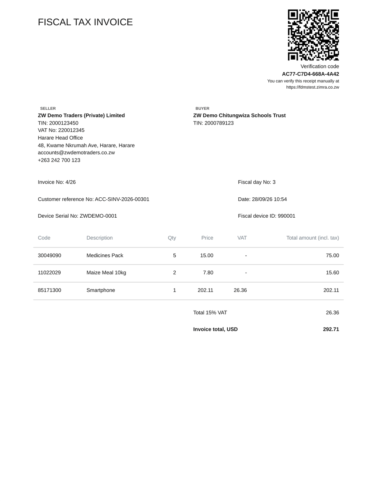 | 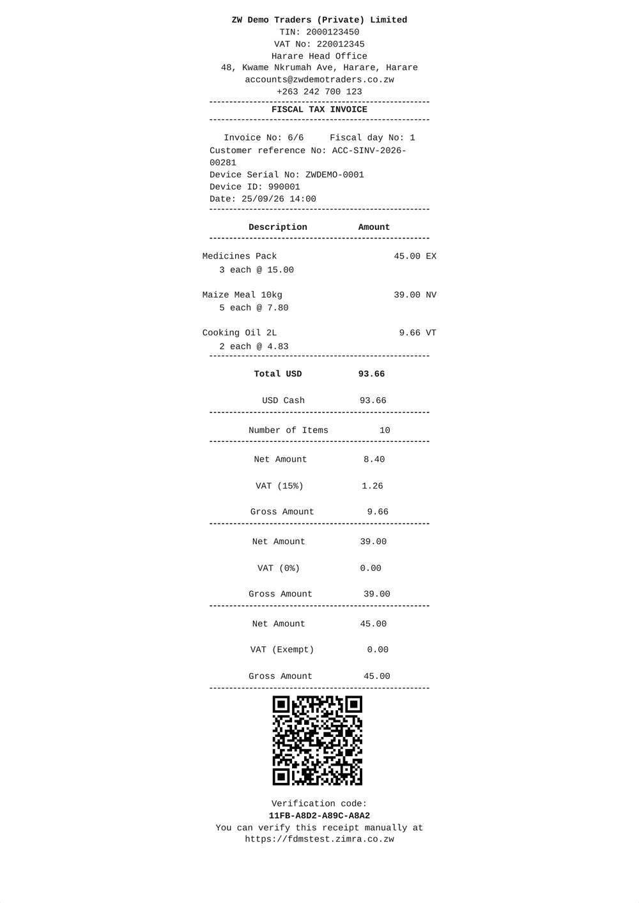 | 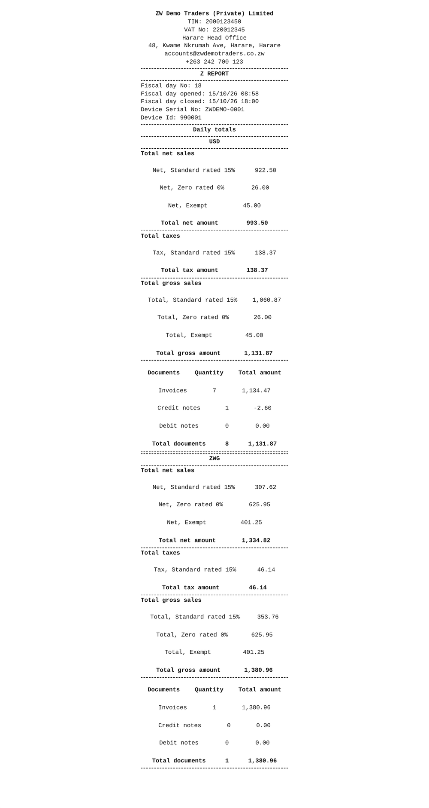 |

And what the business sees in ERPNext, starting with the workspace:

<p align="center">
  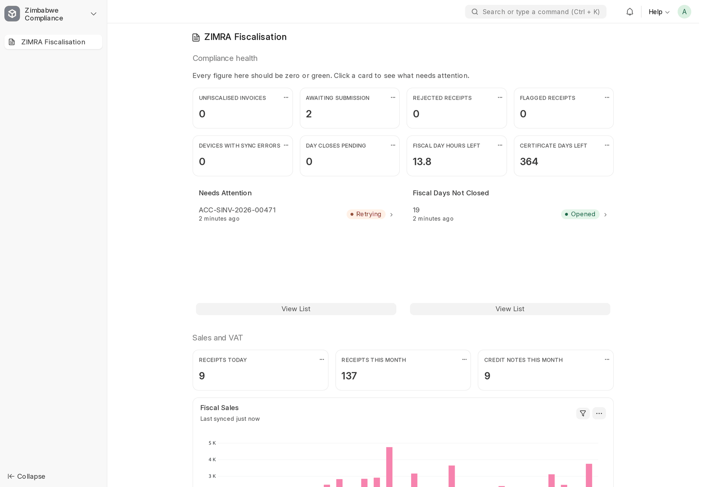
</p>

| | |
|:---:|:---:|
| 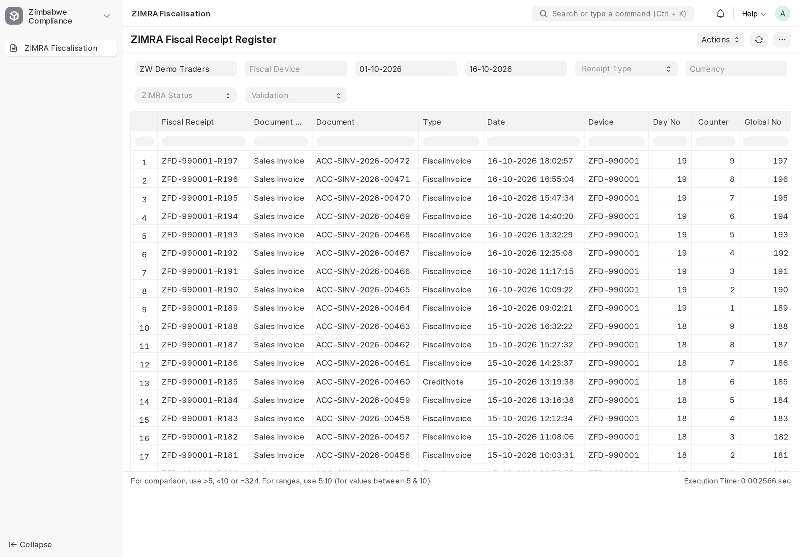<br>**Fiscal Receipt Register**: every receipt with its ZIMRA status | 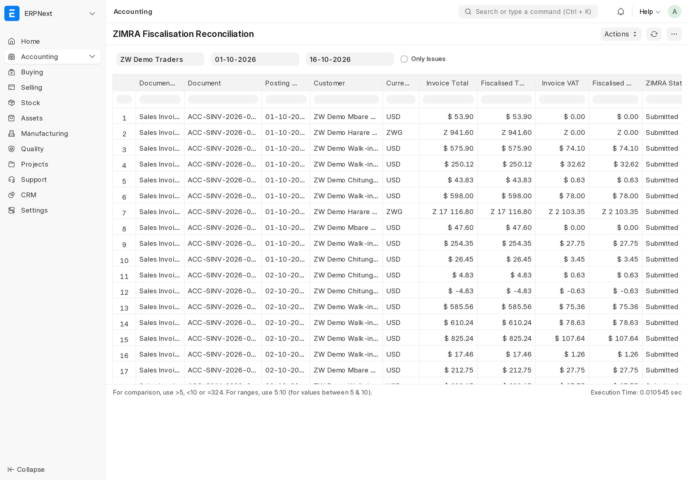<br>**Fiscalisation Reconciliation**: each invoice against its receipt |
| 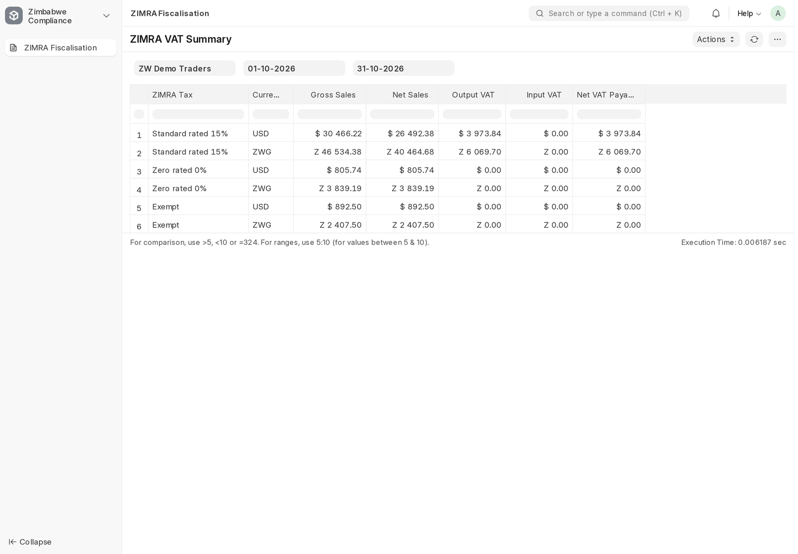<br>**VAT Summary**: output against input VAT, per tax and currency | 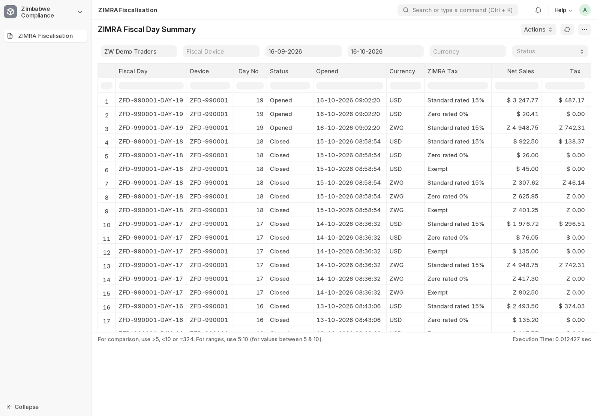<br>**Fiscal Day Summary**: totals per day, tax and currency |
| 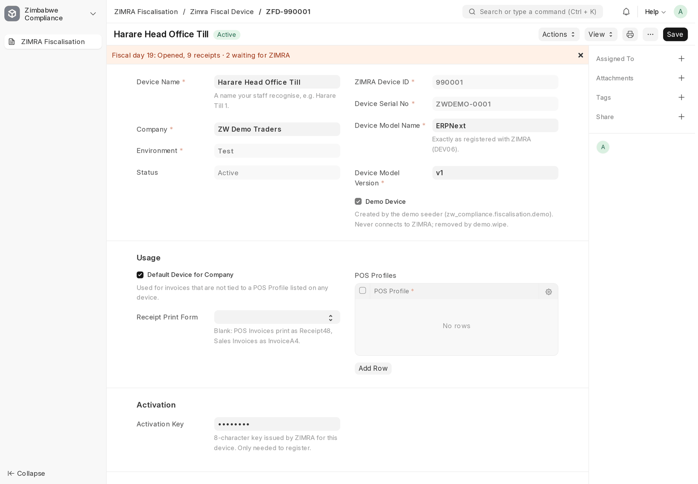<br>**Fiscal device**: guided set-up and live status | 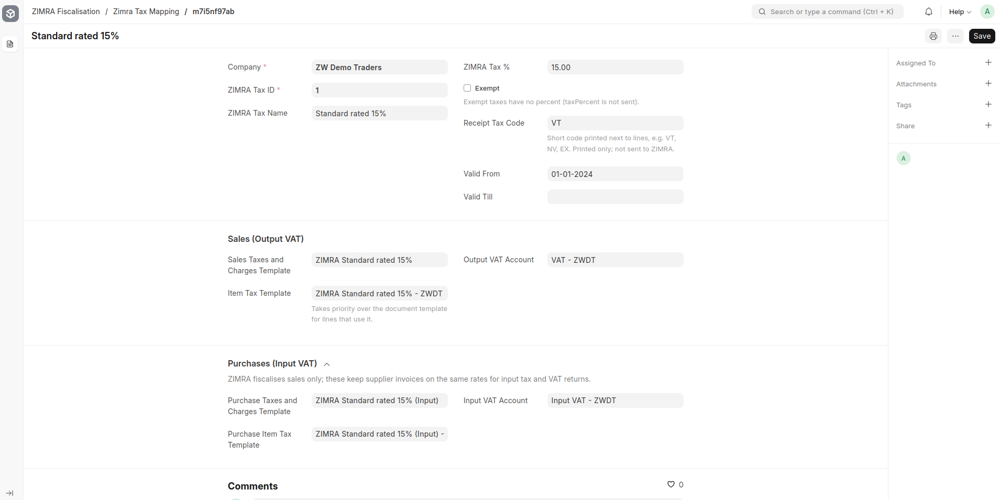<br>**Tax mapping**: ZIMRA taxes tied to ERPNext accounts and templates |

All screenshots use the [demo data](#see-it-with-demo-data).

## See it with demo data

No ZIMRA connection needed: the demo replays three weeks of trading through
the real flow (invoices, credit notes, ZWG sales, daily Z reports, and a
dropped connection today) against the built-in FDMS simulator. It lives in its
own company and is removed with one command.

```bash
bench --site <site> execute zw_compliance.fiscalisation.demo.seed   # ZW Demo Traders
bench --site <site> execute zw_compliance.fiscalisation.demo.wipe   # removes all of it
```

Then switch to the company *ZW Demo Traders* (avatar menu → **Session Defaults**) and open the **ZIMRA Fiscalisation** workspace.

## Install

Requires ERPNext v15 or later.

```bash
bench get-app https://github.com/DonnC/zw_compliance
bench --site <site> install-app zw_compliance
```

Install and every `bench migrate` are idempotent. They create:
- the roles *ZIMRA Manager* and *ZIMRA User*;
- the custom fields (all owned by the app and removed on uninstall);
- the default settings;
- the ZIMRA HS code list.

## Set up a fiscal device (10 minutes)

You need the device ID, serial number and activation key that ZIMRA issued
for the device (from the ZIMRA self-service portal).

1. **Zimra Settings**: check the allowed currencies (default `USD,ZWG`) and map any non-obvious Mode of Payment to a ZIMRA money type.
2. **Zimra Fiscal Device → New**: company, environment (*Test* first), device ID, serial number, model. Tick *Default Device for Company*, or list the POS Profiles that use it. Save.
3. Enter the **activation key** and press **Verify Taxpayer**. ZIMRA returns the taxpayer and branch it has on record. Confirm it is you.
4. Press **Register Device**. The certificate is issued, the configuration is pulled, and taxes are provisioned. The device turns **Active**.
5. Give each item an **HS code** (or set one on the item group). Zero-rated and exempt items get the Item Tax Template the app created.

That's it. Submit a Sales Invoice and the *ZIMRA Fiscalisation* section on it
fills in, with Status *Submitted* a moment later. Moving from another
fiscal system? Enter its last receipt global number in *Last Receipt Global No
of Previous Software* before registering, so numbering continues.

Full walkthrough, end of day and troubleshooting by error code:
[docs/USER_GUIDE.md](docs/USER_GUIDE.md).

## Daily use

| Who | What |
|---|---|
| Cashier, accounts | Nothing new: submit invoices as usual, print with *ZIMRA Receipt48* or *ZIMRA Invoice A4*. For returns use **Create → Return / Credit Note** and give a reason. |
| ZIMRA Manager | Glance at the workspace: *Awaiting Submission*, *Rejected*, *Flagged*. Days close on schedule; use **Close Fiscal Day** to close early. Read the Z report. |
| Accountant | VAT Summary for the return; Fiscalisation Reconciliation before filing. |

## Remote API

Web shops, mobile apps and external tills can fiscalise through a small,
uniform JSON API. Every response is either `{"ok": true, "data": …}` or
`{"ok": false, "error": {"code", "message", "zimra_code"?}}`. Every write is
idempotent through a `client_reference`.

```http
POST /api/method/zw_compliance.api.v1.fiscalisation.fiscalise_invoice
Authorization: token <api_key>:<api_secret>

{"client_reference": "WEB-10031", "customer": "Walk-in", "items": [{"item_code": "SKU-1", "qty": 2}]}
```

Endpoints: `fiscalise_invoice`, `create_credit_note`, `get_receipt`,
`get_device_status`. See [docs/API.md](docs/API.md).

## Quality

- **Specification vectors.** Signing strings and hashes are checked against the worked examples in the ZIMRA specification (credit note §13.2.1, fiscal day §13.3.1, QR §11). They are also checked against vectors from the zimra-fdms SDK that were verified on ZIMRA's live test environment.
- **Integration tests** run real ERPNext documents against an in-process FDMS:
  - onboarding;
  - sale → receipt → ZIMRA;
  - rollback safety, sequencing and chaining;
  - mixed taxes and discounts, B2C and B2B;
  - POS change and POS Invoice consolidation;
  - credit and debit notes;
  - day rollover, close, refused close and Z report;
  - outages, lost answers and 5xx retries;
  - permissions, print formats, reports and the remote API.
- **End to end.** A full cycle over real HTTPS with mutual TLS against the [zimra-fdms](https://github.com/munashe-chivandire/zimra-fdms) simulator.
- **CI** runs all of the above on ERPNext v15 and v16 ([.github/workflows/ci.yml](.github/workflows/ci.yml)).

Every specification rule and where it is enforced and tested:
[docs/COMPLIANCE.md](docs/COMPLIANCE.md).

## Documentation

| Document | For |
|---|---|
| [User guide](docs/USER_GUIDE.md) | Business users and implementers |
| [Compliance matrix](docs/COMPLIANCE.md) | Auditors, reviewers: spec requirement → code → test, judgement calls |
| [Architecture](docs/ARCHITECTURE.md) | Developers |
| [Remote API](docs/API.md) | Integrators |
| [Development](docs/DEVELOPMENT.md) | Contributors: tests, simulator, CI |
| [Changelog](CHANGELOG.md) · [Security](SECURITY.md) · [Contributing](CONTRIBUTING.md) | |

The ZIMRA specification PDF is ZIMRA's document and is not redistributed
here. Obtain it from ZIMRA.

## Roadmap

`zw_compliance` is meant to be the one app a Zimbabwean business installs for
statutory compliance on ERPNext. Each pillar gets its own Frappe module and
service package, as fiscalisation does:

- [x] ZIMRA fiscalisation, online mode
- [ ] ZIMRA offline mode (submitFile / getFileStatus, §4.9–4.10)
- [ ] Payroll: PAYE tables, AIDS levy, tax credits, ITF16, P2 returns
- [ ] NSSA (POBS, APWCS) and ZIMDEF contributions
- [ ] VAT 7 return preparation

## Contributing

Issues and pull requests are welcome; please read
[CONTRIBUTING.md](CONTRIBUTING.md). Report security problems privately, as
described in [SECURITY.md](SECURITY.md).

## Credits

- The protocol work learned a great deal from **[zimra-fdms](https://github.com/munashe-chivandire/zimra-fdms)** by Shaun Chivandire (MIT), a TypeScript SDK tested against ZIMRA's live environment. Its simulator, ported to Python, is the test FDMS here, and its changelog of live findings shaped several safeguards (see [COMPLIANCE.md](docs/COMPLIANCE.md#lessons-from-live-testing)).
- Built on [Frappe](https://frappe.io/framework) and [ERPNext](https://erpnext.com).

## Licence

MIT, see [license.txt](license.txt).
