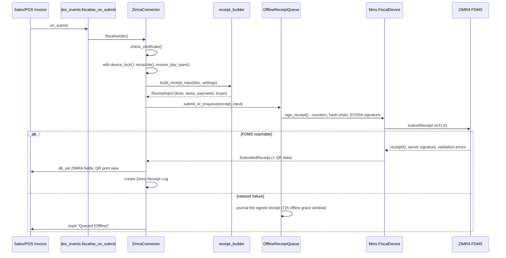

# Zimbabwe Compliance (`zw_compliance`)

Zimbabwe compliance for Frappe/ERPNext — the same idea as `india_compliance`
or the UAE compliance apps, for Zimbabwean businesses. The ERPNext site acts
as a registered ZIMRA **virtual fiscal device**: it registers itself with
FDMS, signs every receipt, manages the fiscal-day lifecycle, and reports
back — all from inside ERPNext, in the ERPNext way (Sales/POS Invoices,
Print Formats, Reports, standard doctype permissions).

**Status**: ZIMRA FDMS fiscalisation (this document) is implemented.
Payroll (PAYE/NSSA/ZIMDEF) and an HS-code catalogue browser are on the
roadmap — see [Roadmap](#roadmap).

## Why this exists

Every Zimbabwean business running ERPNext eventually has to solve ZIMRA
fiscalisation: device registration and certificate lifecycle, the stateful
fiscal-day cycle, receipt counters and the hash chain, canonical signing
strings, tax/payment-mode mapping, HS codes, offline queueing, and FDMS's
own cryptic error codes. This app does that once, correctly, as open source,
wired into ERPNext's native documents instead of a bolt-on middleware
service.

## Architecture

The fiscal engine is deliberately split from the Frappe app around it, the
same way the reference SDK this was built from (see [Credits](#credits))
separates its `core` from its platform adapters:

```
zw_compliance/
├── fdms/                      Pure-Python ZIMRA FDMS protocol engine.
│   │                          No Frappe imports. No I/O beyond what's
│   │                          injected through Signer / Transport / Storage
│   │                          protocols. Fully unit-testable standalone.
│   ├── device.py              FiscalDevice: the fiscal-day/receipt state
│   │                          machine - config, status, open/close day,
│   │                          sign/submit receipts, crash reconciliation
│   ├── signing.py             Canonical signing strings (receipt + fiscal
│   │                          day close) - the byte-exact rules FDMS
│   │                          validates signatures against
│   ├── signer.py              Signer protocol, ASN.1 DER <-> P1363 ECDSA
│   ├── csr.py                 CSR building for device registration/renewal
│   ├── transport.py           Transport protocol, FdmsClient (endpoints,
│   │                          headers, FDMS's own idempotent-only retry
│   │                          rules), the FDMS error catalogue
│   ├── registration.py        RegisterDevice / GetServerCertificate
│   ├── queue.py, journal.py   Offline receipt queue (ZIMRA's 72h grace
│   │                          window), crash-safe by construction
│   ├── money.py               Integer-cents arithmetic (FDMS signs cents;
│   │                          floats are never trusted)
│   ├── qr.py                  Verification QR payload
│   ├── clock.py                Server-corrected clock (survives a drifted
│   │                          device clock without red-flagging receipts)
│   └── tests/                 Conformance vectors + unit tests - runs with
│                              plain pytest, no Frappe site required
│
├── zimra/                     Frappe glue layer: wires fdms/ to a site.
│   ├── connector.py           ZimraConnector - the one entry point every
│   │                          doc hook / whitelisted API / scheduled task
│   │                          calls into
│   ├── storage.py             FrappeFileStorage - atomic, durable fiscal
│   │                          state on disk (never Redis/cache - this
│   │                          state must survive a restart)
│   ├── journal.py             File-backed offline-queue journal
│   ├── transport.py           mTLS transport over `requests`
│   ├── signer.py               EC key handling via `cryptography`
│   ├── lock.py                 Cross-process device lock (flock) so
│   │                          concurrent Frappe workers can't race on
│   │                          receiptGlobalNo
│   ├── receipt_builder.py     Sales/POS Invoice -> ReceiptInput: tax
│   │                          mapping, HS code checks, payment mapping,
│   │                          buyer data, returns/credit-debit notes
│   ├── fiscal_day.py           Syncs device state onto the desk-visible
│   │                          Zimra Fiscal Day doctype
│   ├── qr_render.py           Server-side QR PNG for print formats
│   └── setup.py                Registration + GetConfig tax/account sync
│
├── zimbabwe_compliance/       Frappe module: doctypes, custom fields
├── doc_events.py, tasks.py, api.py    Hook wiring, scheduler, desk API
└── docs/ARCHITECTURE.md       Deeper technical detail: exact signing
                                rules, state machine, offline queue
```

**Why the split matters**: the ZIMRA protocol logic (`fdms/`) has no idea
Frappe exists. It is tested against FDMS's own published conformance
vectors with plain `pytest` (`fdms/tests/test_vectors.py`) - no site, no
database, no ORM. Only `zimra/` and the doctypes know about Frappe. This
keeps the part where a one-byte mistake means a rejected fiscal day
(canonical strings, the hash chain, counter accumulation) small, isolated,
and independently verifiable - and reusable outside ERPNext if that's ever
useful.

## What "virtual device" means here

ZIMRA's FDMS treats every registered device as a black box that: holds a
private key and device certificate, maintains a strictly sequential
receipt counter and a hash chain between receipts, opens and closes fiscal
days with signed counter summaries, and talks to FDMS over mutual TLS.
This app *is* that device - one ZIMRA Settings singleton per ERPNext site,
one key pair, one fiscal-day state machine, backed by durable file storage
(`sites/<site>/private/files/zimra_state/`) so a worker restart or a
network blip never produces a duplicate or skipped receipt number.

## Fiscalisation flow



## Doctype reference

| Doctype | Purpose |
| --- | --- |
| **Zimra Settings** (Single) | Device identity, environment, certificates, allowed currencies, automation config. The read-only "Fiscal State" section mirrors the device's live state for desk visibility - the durable file store, not this doctype, is the source of truth. |
| **Zimra Fiscal Day** | One record per opened/closed fiscal day: counters, document quantities, the exact date used for CloseDay signing. |
| **Zimra Fiscal Day Detail** | Child table: per-currency/tax/money-type totals for a fiscal day. |
| **Zimra Receipt Log** | Immutable record of every fiscalised (or queued) receipt: global no, counter, signatures, QR data, tax breakdown, validation errors. |
| **Zimra Receipt Tax Detail** | Child table: per-tax-ID breakdown on a receipt log. |
| **Zimra Validation Error** | Child table: one FDMS validation error (code, colour, cause, fix), used on both Receipt Log and Fiscal Day. |
| **Zimra Tax Mapping** | ZIMRA numeric tax ID <-> ERPNext Sales Taxes and Charges Template / Item Tax Template / Account. Auto-populated by `sync_config`. |
| **Zimra Payment Mode Mapping** | ERPNext Mode of Payment <-> ZIMRA MoneyType (Cash/Card/MobileWallet/...). |
| **Zimra HSN Code** | The National HS Code catalogue (seeded on install), linked from Item / Item Group. |

## Setup

```bash
cd $PATH_TO_YOUR_BENCH
bench get-app zw_compliance $URL_OF_THIS_REPO --branch main
bench install-app zw_compliance
```

1. **Zimra Settings** → set Company, Environment (Test/Production), Device
   ID, Serial No, Model Name/Version, Activation Key (from the FDMS device
   portal), Allowed Currencies, and the Payment Mode Mapping table.
2. **Register the device** (Zimra Settings → Register Device, or
   `zw_compliance.api.register_device`): generates the device key pair,
   submits a CSR with your activation key, stores the returned certificate.
3. **Sync config** (`zw_compliance.api.sync_config`): pulls taxpayer info
   and applicable taxes from FDMS, and auto-provisions matching ERPNext Tax
   Accounts, Sales Taxes and Charges Templates, and Zimra Tax Mappings.
4. Map each Item/Item Group's **HS Code** and confirm the tax mappings look
   right for your COA.
5. Submit a Sales or POS Invoice. The fiscal day opens automatically (if
   `Auto Open Fiscal Day` is on) and the receipt is fiscalised on submit.

### Offline behaviour

If FDMS is unreachable, the signed receipt is journalled to a durable
append-only file (`zimra/journal.py`) instead of being lost or blocking the
invoice submission - this is ZIMRA's documented 72-hour offline grace
window. `zw_compliance.api.flush_offline_queue` retries the backlog FIFO
once connectivity returns; `queue_status` reports queue depth and the age
of the oldest pending receipt so you can alert before the window closes.

### Certificate lifecycle

`ZimraConnector.check_certificate()` runs once per connector construction
(not per receipt) and hard-blocks fiscalisation with a clear desk error if
the certificate is missing or expired, rather than letting it fail deep
inside an mTLS handshake. A daily scheduled task
(`tasks.check_certificate_renewal`) raises a System Manager notification
starting `certificate_renewal_warning_days` (default 30) before expiry.

### Sequence integrity

`receiptGlobalNo` and the receipt-to-receipt hash chain are never derived
from anything the ERPNext document layer controls - they live only in the
device's durable file-backed state (`zimra/storage.py`), and every
operation that can issue a number goes through `zimra/lock.py`'s
cross-process lock plus `FiscalDevice.reconcile()` first, so concurrent
Frappe workers and a half-finished request from a previous crash can never
produce a duplicate or gap in the sequence (FDMS error RCPT012).

## Development

```bash
cd apps/zw_compliance
pre-commit install        # ruff, eslint, prettier, pyupgrade

# Fiscal engine tests - no Frappe site needed:
pip install pytest
PYTHONPATH=. pytest zw_compliance/fdms/tests/

# Frappe-level tests:
bench --site $SITE set-config allow_tests true
bench --site $SITE run-tests --app zw_compliance
```

`zw_compliance/fdms/tests/test_vectors.py` replays
[zimra-fdms](https://www.zimrasdk.com/)'s own published conformance vectors
(canonical strings, hashes, ECDSA signatures, tax rounding, QR payloads)
against this Python port and asserts byte-for-byte agreement. Any change to
`fdms/signing.py` or `fdms/device.py`'s receipt/counter maths should keep
this suite green.

For end-to-end testing without touching ZIMRA's real test environment, the
reference SDK ships a local FDMS simulator with real mutual TLS and the
same validation-error replay behaviour as the live test environment:

```bash
npx zimra-fdms-simulator --port 8443   # writes zimra-simulator-ca.pem
```

Point `Zimra Settings` → API URL Override at `https://localhost:8443` and
the FDMS Server Certificate attachment at the simulator's CA to run the
full register → open day → submit → close day cycle against it in CI or
locally.

## Roadmap

- [x] ZIMRA FDMS fiscalisation (device registration, fiscal-day lifecycle,
      receipt signing/QR, returns, offline queue, reports)
- [ ] Payroll: PAYE tables, NSSA, ZIMDEF, AIDS Levy
- [ ] HS Code catalogue browser + bulk-assignment tooling
- [ ] E-invoicing / e-signature helpers for non-fiscal documents

Issues and PRs for any of the above are welcome.

## Credits

The ZIMRA FDMS canonical signing rules, state-machine design and hard-won
protocol details (ASN.1 DER vs P1363 signatures, the fiscal-day-opened-date
quirk in CloseDay signing, counter sort orders, QR format) this app's
`fdms/` package is ported from
**[zimra-fdms](https://www.zimrasdk.com/)** ([source](https://github.com/munashe-chivandire/zimra-fdms)),
an MIT-licensed TypeScript SDK verified live against ZIMRA's FDMS test
environment. `zw_compliance/fdms/` is an independent Python port of its
protocol logic (not a generated or mechanical translation), re-implemented
against the same conformance vectors it publishes; see
[docs/ARCHITECTURE.md](docs/ARCHITECTURE.md) for the specific deviations
and why each was made. If you need managed ZIMRA onboarding, approval or
ongoing compliance monitoring rather than the DIY integration, the SDK's
authors point to **Goko Consultancy and Training Services**.

### Contributing

This app uses `pre-commit` for code formatting and linting:

```bash
cd apps/zw_compliance
pre-commit install
```

Tools: `ruff`, `eslint`, `prettier`, `pyupgrade`.

### License

MIT
