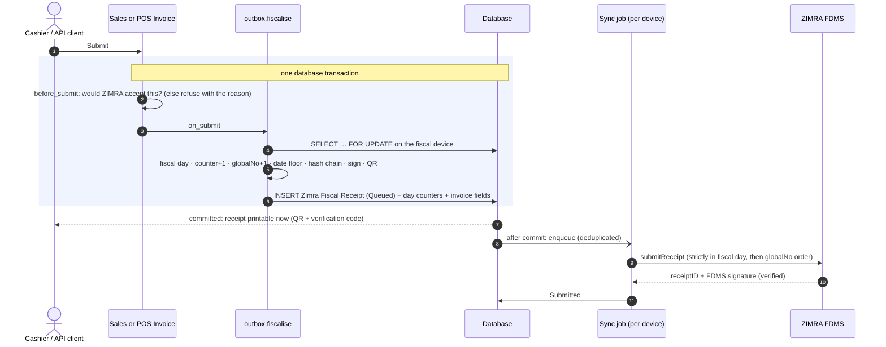
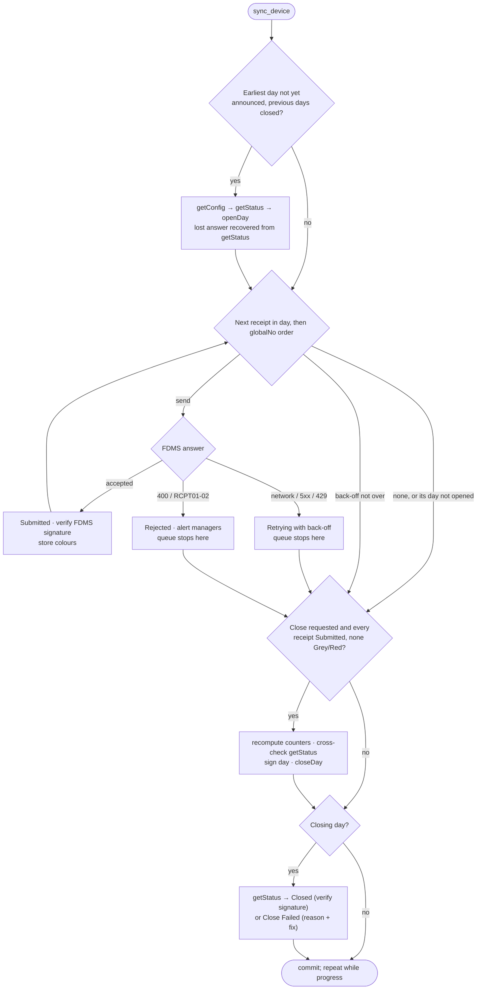
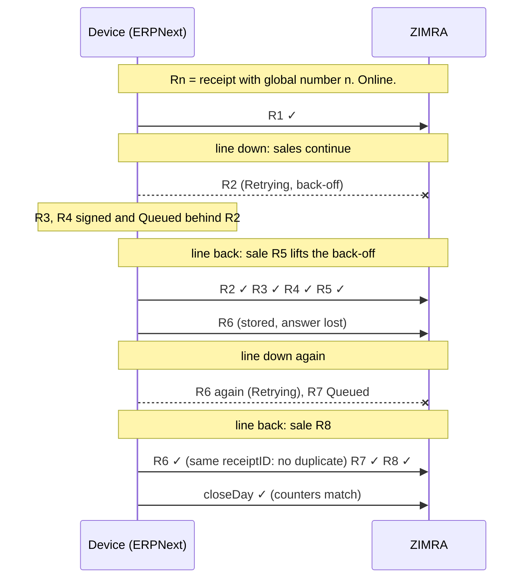
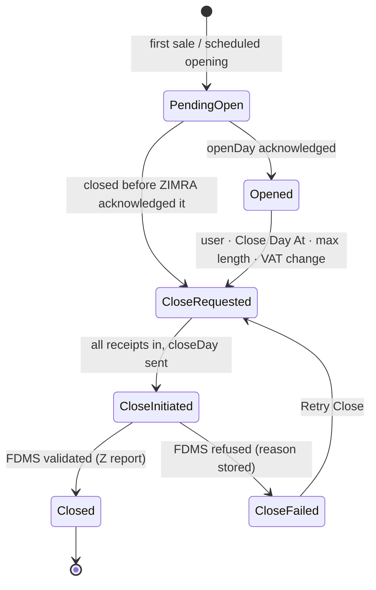

# Architecture

This document explains how `zw_compliance` turns an ERPNext site into a ZIMRA
fiscal device, and why it is built this way. Section numbers (§) refer to
ZIMRA's *Fiscal Device Gateway API* v7.2, by the numbers of the headings in
the body of the document (the table of contents is one number off from §4.8
onwards).

## Goals

1. **Never break the sequence.** ZIMRA identifies a receipt by `receiptGlobalNo`, chains each receipt to the previous one by hash, and refuses to close a day with a gap. A missing, duplicated or reordered number is a permanent compliance defect. Everything else is subordinate to this.
2. **Never block the business.** Invoicing must not stop when the internet does.
3. **Online in real time.** When ZIMRA is reachable, a receipt is accepted seconds after submit (§9 req. 14).
4. **The ERPNext way.** Native documents, permissions, print formats, reports, accounts and templates. No sidecar service.

## Layers

```
zw_compliance/
├── fdms/                 ZIMRA protocol, pure Python (no Frappe imports)
├── fiscalisation/        Frappe service layer: ERPNext ⇄ fdms
├── zimra_fiscalisation/  Frappe module: doctypes, reports, print formats, workspace
├── zimbabwe_compliance/  Frappe module: shared masters (Zimra HSN Code); future pillars
├── api/v1/               Remote JSON API for external clients
└── templates/zimra/      Jinja for the §10 receipt, invoice and Z/X report views
```

### `fdms/`: the protocol

A library that knows ZIMRA and nothing about ERPNext. It can be used by any
Python program and is tested with plain `pytest`.

| Module | Responsibility |
|---|---|
| `types.py` | Dataclasses and enums of the API (§5): receipts, counters, taxes, config, status |
| `money.py` | `Decimal` arithmetic, half-even rounding, cents; proportional splitting by largest remainder |
| `receipt.py` | Builds a receipt from neutral input: tax per group (RCPT026), line and payment checks. `validate_receipt` enforces locally every §8.2.1 rule that can be checked without FDMS. Fiscal counters (§6) |
| `signing.py` | Canonical strings for the receipt (§13.2.1), the fiscal day (§13.3.1) and FDMS's countersignatures (§13.2.2, §13.3.2) |
| `signer.py`, `csr.py` | P-256 key generation, ECDSA / RSA signing, CSR with CN `ZIMRA-<serial>-<deviceID>` (§12) |
| `qr.py` | QR URL and the 16-character verification code (§11) |
| `wire.py` | JSON in and out, using the field names of ZIMRA's published Swagger |
| `client.py` | `FdmsClient`: endpoints, headers (`DeviceModelName`, both `DeviceModelVersion` spellings), 30 s timeout (§7.4), retry of idempotent calls only, ProblemDetails → `FdmsApiError` |
| `verify.py` | Verifies FDMS's receipt and day signatures against its certificate chain |
| `clock.py` | Learns the device-to-server clock offset from HTTP `Date` headers |
| `errors.py` | The complete §8.2 / §8.2.1 / §5.4 error catalogue, with a plain-language fix for each code |

The transport is injected (`Transport` protocol), so the client is tested
without a network and the Frappe layer can plug in `requests` with mutual TLS.

### `fiscalisation/`: ERPNext onto the protocol

| Module | Responsibility |
|---|---|
| `validation.py` | `validate` and `before_submit` hooks: refuse, with a reason, any invoice ZIMRA would reject (currency, TIN, HS codes, discounts, credit-note rules), by building and checking the receipt before submit |
| `builder.py` | ERPNext invoice → `ReceiptDraft`. Taxes come from the mapping of Item Tax Template / Taxes and Charges Template to ZIMRA tax, lines are reconciled to `grand_total`, plus payments, buyer and the credit/debit note reference |
| `outbox.py` | `on_submit`: sign and store the receipt in the invoice's transaction |
| `sync.py` | Background job that talks to FDMS |
| `day.py` | Fiscal-day state: local opening, rollover, close requests, counter recomputation |
| `device.py` | Device lifecycle: verify, register, configure, renew, ping; `connect()` builds an mTLS client |
| `taxes.py` | Accounts, templates and mappings from ZIMRA's tax table |
| `schedule.py` | Scheduler jobs |
| `guards.py` | No cancel or delete of fiscalised invoices; fiscal fields cleared on copy |
| `credentials.py` | Encrypted key storage; short-lived 0600 files for the TLS handshake |
| `print_utils.py` | Jinja helpers for the print formats |
| `api.py` | Desk actions (whitelisted, manager roles only) |
| `setup/` | Custom fields, roles, settings defaults, HS code seed, uninstall guard |

## The transactional outbox



**Why sign locally, inside the transaction?** Everything ZIMRA needs to
accept a receipt (number, counter, previous hash, signature) is derived from
local data. If signing happened after the invoice committed, a crash in
between would leave an invoice without a receipt. If the FDMS call happened
before commit, a later rollback would leave ZIMRA with a receipt that has no
invoice, and the number would be burned for good. Doing all of it in one
transaction makes the invoice and its fiscal receipt one atomic fact. The row
lock on the device serialises numbering across web workers and hosts.

**Why a queue, even online?** The specification allows it (§9 req. 14:
"otherwise receipt must be put to the queue"), and it gives one code path.
After commit a job is enqueued immediately (deduplicated per device), so in
online mode the receipt reaches ZIMRA within seconds. Offline, the same job
drains the queue when the connection returns. The every-minute scheduler is
the safety net.

**Date floor.** A receipt's date is the server-corrected clock, but never
earlier than or equal to the latest of:
- the day's opening;
- the previous receipt in the day;
- the latest receipt of the device.

ZIMRA flags same-second or back-dated receipts (RCPT030). The device-wide
floor follows a live finding of the zimra-fdms SDK: once one receipt is
future-dated, every later one must be dated after it.

## The sync job

`sync.sync_device` takes a file lock per device and is de-duplicated by job
ID, so one runner works on a device at a time. Each pass, until nothing is
left:



1. **Open.** For the earliest day not yet announced, and only when every earlier day is closed:
   - getConfig, which refreshes taxpayer data, taxes and VAT status (§9 req. 2);
   - getStatus;
   - openDay with the device's own day number. A lost openDay answer is recovered from getStatus.
2. **Submit.** Queued and Retrying receipts go one at a time in fiscal day, then `receiptGlobalNo` order (§9 req. 13); the day comes first because global numbers may start again at 1 in a new day. The queue stops at the first failure, because skipping would break the chain. Re-sending is safe: FDMS answers a duplicate with the original receiptID (§4.7).
3. **Close.** Once all of a day's receipts are Submitted and none is Grey or Red (§4.11), counters are recomputed from the signed payloads, compared with the incremental ones and with getStatus, the day is signed (§13.3.1) and closeDay is sent.
4. **Poll.** getStatus until FiscalDayClosed (FDMS's day signature is verified) or a refusal (Close Failed, with the error code and fix).

Each step commits, so progress survives a crash.

## Failure handling

The rule underneath everything: **the sequence is decided locally, once, at
submit, and never again**. Connectivity only affects *when* ZIMRA hears about
a receipt, never its number, hash or content.

| What fails | What happens | Sequence impact |
|---|---|---|
| Invoice submit fails after signing (any error, any later hook) | The whole transaction rolls back, including the receipt and the counters | None: no number is used |
| Two cashiers submit at once | The device row lock serialises them | None: consecutive numbers |
| ZIMRA unreachable | Receipts are signed, printed and stay *Queued*. The head receipt goes *Retrying* with back-off (30 s doubling to 30 min) | None: later receipts wait behind it |
| Connection returns | The next sale (or **Send Now**) lifts the back-off at once, and the queue drains in order. Without a sale, the every-minute scheduler resumes after the back-off | None |
| ZIMRA stored a receipt but the answer was lost | Marked *Retrying*; re-sent with the same number and hash; ZIMRA returns the original receiptID (§4.7) | None: no duplicate |
| openDay or closeDay answer lost | Recovered from getStatus | None |
| ZIMRA 5xx or 429 | Same as unreachable | None |
| ZIMRA refuses a receipt outright (400, RCPT01/02) | *Rejected*; queue stops; managers alerted | Held: later receipts are never sent ahead of it |
| ZIMRA flags a receipt (Yellow/Grey/Red) | Stored on the receipt and surfaced in the workspace; Grey/Red block the close | None |
| Worker crashes mid-run | Every step commits; the next run resumes | None |
| Day reaches its maximum length while offline | The day is marked for closing; new sales go into the next day, announced once the previous day closes | None: global numbers continue (or restart at 1 in the new day, if the device's numbering policy says so) |

A connection that flaps (up, down with sales, up, down again with a lost
answer, up) is covered end to end by
`test_sequence_survives_a_flapping_connection`:



## Fiscal days



| Status | Meaning |
|---|---|
| Pending Open | Created locally (first sale, or scheduled opening); openDay not yet acknowledged. Receipts may already be issued: the opening message may be delayed (§9 req. 10) and receipts are sent only after it (req. 11) |
| Opened | Acknowledged by ZIMRA |
| Close Requested | By a user, the schedule, the maximum day length, or a VAT status change (§9 req. 4, 9) |
| Close Initiated | closeDay accepted; ZIMRA validates asynchronously |
| Close Failed | ZIMRA refused; reason stored; can be retried |
| Closed | Z report available; FDMS day signature stored |

When the current day is closing or near its maximum length, the next receipt
goes into a new Pending Open day. ZIMRA allows one open day per device, so
that day is announced as soon as the previous close completes.

## Data model

| Doctype | Role |
|---|---|
| Zimra Fiscal Device | One per ZIMRA device: identity, lifecycle status, taxpayer and config snapshot, certificate (permlevel 1), key (encrypted, permlevel 1), runtime state. Row-locked while signing |
| Zimra Fiscal Day | One per device and day number (unique): status, counters, last hash, signatures, operation IDs |
| Zimra Fiscal Receipt | The outbox and the audit record. Unique per (device, fiscal day, globalNo), per source document, and per invoice number. Holds the exact signed payload, the seller snapshot used for printing, and FDMS's answer. Immutable after insert; never deletable; read-only for every role |
| Zimra Tax Mapping | ZIMRA tax ↔ accounts and templates, per company |
| Zimra Settings | Global: currencies, money types, automation, notifications |
| Zimra HSN Code | ZIMRA's HS list (4 or 8 digits usable on receipts) |

Custom fields on Sales Invoice and POS Invoice (section *ZIMRA
Fiscalisation*) mirror the receipt for list views and printing. They are
read-only and `no_copy`, and are cleared on insert of any copy. Customer gets
`zimra_vat_number` and `zimra_trade_name`; the TIN is ERPNext's `tax_id`.
Item and Item Group get `zimra_hs_code`. All fields are created in code with
`module = "ZIMRA Fiscalisation"`, so uninstall removes them.

## Security

- **Device key.** Generated on the server, stored in a Password field (encrypted with the site's key) at permlevel 1. It is written to a 0600 temporary file under `sites/<site>/private/zimra/` only for the TLS handshake, and deleted straight after.
- **Roles.**
  - *ZIMRA Manager* runs devices and days.
  - *ZIMRA User* reads receipts, days and reports.
  - Fiscal receipts and days are read-only for all roles; only code writes them.
  - Desk actions check roles with `frappe.only_for`.
  - The remote API acts as the calling user, so ERPNext's own permissions apply.
- **FDMS authenticity.** Receipt and day countersignatures are verified against ZIMRA's certificate chain, chosen by thumbprint.

## Extending to new pillars

Payroll, NSSA and ZIMDEF follow the same shape:
- a Frappe module for doctypes, reports and workspace;
- a service package for hooks and jobs;
- where a protocol or statutory computation is involved, a pure library tested without Frappe.

Shared masters belong in `zimbabwe_compliance`.
