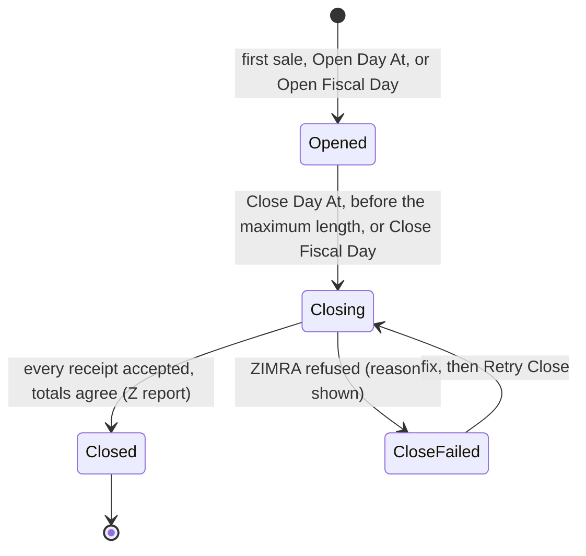

# User guide

For business owners, accountants, ZIMRA managers and the implementers who set
ERPNext up for them.

- [Before you start](#before-you-start)
- [Roles](#roles)
- [Setting up](#setting-up)
- [Selling](#selling)
- [Returns, credit notes and debit notes](#returns-credit-notes-and-debit-notes)
- [Fiscal days](#fiscal-days)
- [Printing](#printing)
- [When the internet is down](#when-the-internet-is-down)
- [Reports and the workspace](#reports-and-the-workspace)
- [Suppliers and input VAT](#suppliers-and-input-vat)
- [Certificates](#certificates)
- [Troubleshooting](#troubleshooting)
- [Trying it out with demo data](#trying-it-out-with-demo-data)

## Before you start

You need:
- the **Device ID**, **serial number** and **activation key** ZIMRA issued for the device. You get these from the ZIMRA self-service portal or your ZIMRA office. Each till or invoicing point that must report separately is its own device;
- ERPNext with your company, chart of accounts and fiscal year set up;
- `zw_compliance` installed.

Start in ZIMRA's **Test** environment, go through a day of sales, returns and
a close, then register a **Production** device.

## Roles

| Role | Can |
|---|---|
| **ZIMRA Manager** | Set up devices, settings and tax mappings; open and close fiscal days; send now; renew certificates. Receives alerts |
| **ZIMRA User** | View fiscal receipts, days, reports and the workspace |
| Accounts User / Manager | As usual in ERPNext; can view fiscal receipts |

Nobody, not even System Manager, can edit or delete a fiscal receipt. That
is deliberate: once signed, a receipt is a tax record.

## Setting up

### 1. Zimra Settings

| Setting | What it does | Default |
|---|---|---|
| Allowed Currencies | Invoices in other currencies are refused | `USD,ZWG` |
| Money Type for Unpaid Balance | How the unpaid part of an invoice is reported | Credit |
| Money Type for Advances | How allocated advances are reported | BankTransfer |
| Payment Mode Mapping | Mode of Payment → ZIMRA money type, when ERPNext's payment type (Cash, Bank, Phone…) is not enough | empty |
| Open Fiscal Day Automatically | Open the day on the first sale. When off, a day that reaches its maximum length is still followed by a new one, so sales never stop | On |
| Open Day At | Also open a day at this time each day | empty |
| Close Day At | Close the day at this time each day | empty |
| Close Before Maximum (hours) | Close this long before ZIMRA's maximum day length | 1 |
| Report Device Online (Ping) | Tell ZIMRA the device is online, as often as ZIMRA asks | On |
| Certificate Warning (days) | Warn this long before the certificate expires | 30 |
| Renew Certificates Automatically | Renew without asking | On |
| Notify Role | Who receives alerts | ZIMRA Manager |

### 2. Register the device

1. **Zimra Fiscal Device → New.**
   - Pick the company and the environment.
   - Enter the Device ID, Serial No, model name and model version exactly as registered with ZIMRA.
   - Tick **Default Device for Company**, or add the POS Profiles this device serves (several devices per company are supported).
   - If you are moving from another fiscal system, enter the global number of its last receipt in **Last Receipt Global No of Previous Software**.
   - Optionally choose when global numbers start again at 1 under **Receipt Numbering** (see [Global receipt numbers](#global-receipt-numbers)).
   - Save.
2. Enter the **activation key**, then press **Verify Taxpayer**. ZIMRA answers with the taxpayer name, TIN, VAT number and branch it holds for this device. Confirm only if they are yours.
3. Press **Register Device**. ERPNext generates the device key, receives the ZIMRA certificate and fetches the configuration. It also sets up taxes (next step). The status becomes **Active**.

### 3. Taxes (done for you)

From ZIMRA's tax table the app creates, for the company:
- accounts **VAT** (liability, output) and **Input VAT** (asset);
- one **Sales** and one **Purchase Taxes and Charges Template** per ZIMRA tax. The standard-rated ones become the company defaults, unless you already have defaults;
- one **Item Tax Template** per ZIMRA tax (sales and purchase);
- a **Zimra Tax Mapping** row per ZIMRA tax, linking all of the above. You can point a mapping at your own existing templates or accounts instead.

Then:
- standard-rated items need nothing;
- give **zero-rated** and **exempt** items the matching Item Tax Template on the item's *Taxes* table.

### 4. HS codes

ZIMRA requires an HS code on every line for VAT-registered sellers:
- 8 digits for zero-rated and exempt lines;
- 4 or 8 digits otherwise.

Set **ZIMRA HS Code** on the item, or once on the item group (items inherit it).
ZIMRA's national list is pre-loaded, and only codes usable on a receipt can
be picked.

### 5. Customers

For business customers, fill in **Tax ID** (the 10-digit TIN) and, if
VAT-registered, **VAT Number** (9 digits, just below Tax ID). Their details then print on
the invoice and are sent to ZIMRA. Leave both empty for walk-in customers.

## Selling

Nothing changes for whoever does the selling. Create and submit a Sales
Invoice or POS Invoice as usual. On submit, ERPNext:

1. checks the invoice the way ZIMRA would. If something would be rejected, for example a missing HS code, a wrong TIN or a currency not allowed, the submit stops with an explanation;
2. numbers, signs and stores the fiscal receipt, as part of the same save;
3. sends it to ZIMRA a moment later.

The **ZIMRA Fiscalisation** section on the invoice shows the device, fiscal
day, receipt counter and global number, verification code and status:

| Status | Meaning |
|---|---|
| Queued | Signed, on its way to ZIMRA |
| Retrying | ZIMRA could not be reached; it will be sent automatically |
| Submitted | Accepted by ZIMRA |
| Rejected | ZIMRA refused it; see [Troubleshooting](#troubleshooting) |

A fiscalised invoice **cannot be cancelled or deleted**. Correct it with a
credit note or debit note.

Notes:
- Rounded totals are switched off on fiscal invoices, because ZIMRA receipts carry exact amounts.
- Discounts on lines and on the net total work. A *cash / non-trade discount* is refused, because it lowers the total without lowering VAT.
- POS: change given is deducted from cash, and rounding is absorbed in cash. When POS Invoices are consolidated at closing, the consolidated Sales Invoice is not fiscalised again.

## Returns, credit notes and debit notes

- **Credit note**: on the original invoice, **Create → Return / Credit Note**. You can return part of it. Fill in **Reason for Credit / Debit Note** (ZIMRA requires it). ZIMRA's rules apply:
  - same currency as the original;
  - original not older than 12 months;
  - only the original's taxes;
  - in total, no more than the original.
- **Debit note**: for an under-charge, create a new Sales Invoice for the extra amount. Tick **Is Rate Adjustment Entry (Debit Note)**, pick the original in **Adjustment Against**, and give the **Reason for Credit / Debit Note**.

Both print as CREDIT NOTE / DEBIT NOTE and reference the original receipt.

## Fiscal days

A fiscal day groups receipts between an opening and a Z report. ZIMRA limits
how long a day may stay open (for example 24 hours).



- **Opening.** Automatic on the first sale, or at *Open Day At*, or by hand with **Open Fiscal Day**.
- **End-of-day notice.** Managers are alerted a few hours before the maximum length (ZIMRA sets how many).
- **Closing.**
  - Automatic at *Close Day At*, or before the maximum length (minus the margin).
  - Or by hand: open the fiscal day and press **Close Fiscal Day**.
  - ERPNext waits until every receipt is accepted, checks the totals against ZIMRA, and sends the close.
  - The day becomes **Closed** and the **Z Report** is available.
- Sales made while a day is closing go into the next day automatically.
- **Close Failed.** ZIMRA refused the close; the reason and the fix are on the day. Fix the cause, then press **Retry Close**.

### Global receipt numbers

Every receipt carries a global number that runs on across fiscal days. ZIMRA
accepts a restart at 1 only with the first receipt of a fiscal day, and rejects
one in the middle of a day, so ERPNext only ever restarts it when a new day
begins. Choose when on the fiscal device, under **Receipt Numbering**:

| Global Number Reset | The global number starts again at 1 |
|---|---|
| **Near Limit** (default) | In the first new fiscal day after it passes 90% of the limit, so normally at an ordinary day boundary. |
| **Every Fiscal Day** | In every new fiscal day. |

**Global Number Limit** is blank by default, meaning the largest number a
receipt can carry (2,147,483,647). Numbering then simply continues: at 100,000
receipts a day that lasts about 59 years. Set a lower limit to restart earlier,
for example to keep printed numbers short.

Invoicing never stops at the limit. After it, the only number ZIMRA accepts is
1 in a new fiscal day, so if the limit is reached during a day, under either
setting, ERPNext closes that day and the next sale opens a new one starting
at 1. ZIMRA allows a day to be closed at any time. ZIMRA Managers are alerted
and the reason is recorded on the fiscal day, because a Z report then appears
during trading.

A receipt is identified by its fiscal day and global number together, so
credit notes always point at the right original, before or after a restart.

### Fiscal days and trading hours

ZIMRA does not tie fiscal days to calendar days or business hours. A day lasts
from its opening to its close, at most the device's **Maximum Fiscal Day**
hours; a day may run past midnight, and one date may have several days. Fit
days to your trading hours with *Open Day At* and *Close Day At* in Zimra
Settings, or close by hand.

## Printing

| Print format | Use |
|---|---|
| ZIMRA Receipt48 / ZIMRA Receipt48 Sales Invoice | 80 mm till slips (ZIMRA's Receipt48 view) |
| ZIMRA Invoice A4 / ZIMRA Invoice A4 POS Invoice | A4 tax invoices (ZIMRA's InvoiceA4 view) |
| ZIMRA Z Report (on Zimra Fiscal Day) | Z report of a closed day; X report of an open one |

Each fiscal print carries the QR code and verification code your customer
can check on ZIMRA's site. To make a format the default, set it as the
*Default Print Format* in **Customize Form** for Sales Invoice or POS Invoice.

## When the internet is down

Keep selling. Receipts are signed and printed with their QR code as usual,
and wait with status *Queued* or *Retrying*. When the connection returns they
are sent automatically, in order, starting with the next sale. A connection
that comes and goes several times is fine: numbers are fixed when the invoice
is submitted, so ZIMRA always receives them in sequence, once each. **Send Now** on the device (or on a
receipt) retries immediately. A day cannot be closed until its receipts are
in.

## Reports and the workspace

Open the **ZIMRA Fiscalisation** workspace.

| Report | Answers |
|---|---|
| Fiscal Day Summary | Per day: receipts, totals, tax, status |
| Fiscal Receipt Register | Every receipt, filterable by device, day, type, currency, status |
| Sync Exceptions | What has not reached ZIMRA, and what ZIMRA flagged, with the fix |
| VAT Summary | Output VAT from fiscal receipts vs input VAT from purchases, per tax |
| Fiscalisation Reconciliation | Every submitted invoice vs its fiscal receipt: missing receipts, total or tax differences |
| Device Status | Certificate days left, day age vs maximum, last ping and sync, queue |

**Compliance health** (each should be zero or comfortably high):

| Card | Act when |
|---|---|
| Unfiscalised Invoices | Above zero: an invoice escaped fiscalisation; open the reconciliation |
| Awaiting Submission | Stays up for long: check the connection (Device Status) |
| Rejected Receipts | Above zero: fix the receipt; later ones wait behind it |
| Flagged Receipts | Grey/Red: blocks the day close; see Sync Exceptions |
| Devices With Sync Errors | Above zero: open the device, read *Last Sync Error* |
| Day Closes Pending | Stays up: a close is waiting or failed |
| Fiscal Day Hours Left | Low: the day will be closed automatically; or close it now |
| Certificate Days Left | Under 30: renew the certificate |

The lists *Needs Attention* and *Fiscal Days Not Closed* show the records
behind them.

**Sales and VAT**:
- fiscal sales per day for the last 30 days;
- output VAT this month per ZIMRA tax;
- receipts by status, by type and per day;
- receipts today and this month, and credit notes this month.

Money charts show one currency at a time (company currency by default); pick
another in the chart's filter.

Run *Fiscalisation Reconciliation* before every VAT return.

## Suppliers and input VAT

Supplier (purchase) invoices are not fiscalised: that is your supplier's
duty. Use the purchase templates the app created, or the zero-rated / exempt
Item Tax Templates (Input). VAT is then booked to **Input VAT**, and the VAT
Summary shows it against output VAT. Record the supplier's TIN in the
supplier's Tax ID.

## Certificates

A device certificate is valid for a limited time (ZIMRA decides).
- Managers are warned *Certificate Warning (days)* before expiry.
- Renew with **Actions → Renew Certificate**, or enable automatic renewal.
- An expired certificate stops all communication with ZIMRA. Sales do not stop: invoices still submit, with a warning, and queue. Nothing reaches ZIMRA until ZIMRA issues the device a new certificate.

## When ZIMRA is unavailable

Sales never wait for ZIMRA, however long an outage lasts. Invoices are
fiscalised and signed locally and queue in order. Fiscal days still close
and roll over locally at their maximum length. Retries back off to every 30
minutes, and the queue is sent in order once ZIMRA is back. Watch the
**Sync Exceptions** report during a long outage.

## Troubleshooting

Messages name the ZIMRA code. The most common:

| Code | Meaning | Fix |
|---|---|---|
| RCPT047 / RCPT048 | HS code missing or wrong length | Set an 8-digit code (zero-rated, exempt) or a 4/8-digit code on the item or item group |
| RCPT043 | Buyer data incomplete | Customer has a TIN but no name, or a malformed TIN: fix the customer |
| RCPT034 | Credit/debit note without a reason | Fill in Reason for Credit / Debit Note |
| RCPT033 / 035 / 036 / 042 | Credit note breaks a rule about the original | See [Returns](#returns-credit-notes-and-debit-notes) |
| RCPT021 | VAT charged by a non-VAT taxpayer | Your ZIMRA registration has no VAT number; use the zero/exempt templates, or update your registration and **Sync Configuration** |
| RCPT011 / RCPT012 (Grey) | ZIMRA is missing an earlier receipt | Usually resolves when the earlier receipt arrives. If one is Rejected, fix it first: the queue never skips |
| RCPT030 / RCPT031 | Receipt date out of order or in the future | Check the server clock (NTP). The app corrects small drifts automatically |
| DEV01 | Device not active at ZIMRA | Check the device status on the ZIMRA portal |
| FISC01 | A fiscal day is already open at ZIMRA | It was opened elsewhere; close it there or on the portal |
| BadCertificateSignature / CountersMismatch (day close) | ZIMRA's figures differ from ERPNext's | Open *Sync Exceptions*; once fixed press **Retry Close** |
| HTTP 401 | Certificate refused | Renew the certificate, or re-register if it expired |

A **Grey** or **Red** receipt blocks the day close. Some can only be
resolved on the ZIMRA portal. The day shows which receipts are involved.

Every alert also appears in the bell (Notification Log) of the *Notify Role*.

## Trying it out with demo data

To see what the workspace and reports look like before going live, an
administrator can load a demo. It creates the company *ZW Demo Traders* with
three weeks of sales, credit notes, ZWG invoices and daily Z reports, all
fiscalised by a built-in ZIMRA simulator. Its device is marked **Demo Device**
and never connects to ZIMRA.

```bash
bench --site <site> execute zw_compliance.fiscalisation.demo.seed
bench --site <site> execute zw_compliance.fiscalisation.demo.wipe
```

`wipe` removes everything the demo created, and nothing else.
